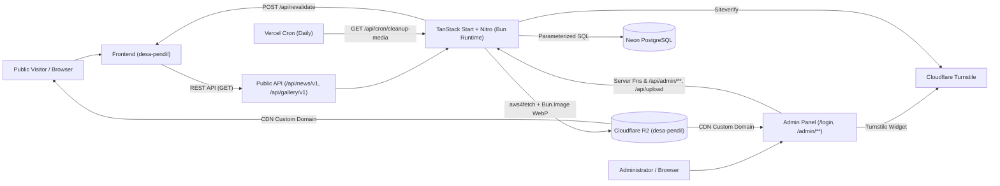

# Desa Pendil Backend

API service and administrative panel for the Desa Pendil website. Administrators manage news, articles, announcements, and photo galleries here, while the public frontend consumes them via the REST API.

Built with **TanStack Start**, **TanStack Router**, **Vite 8**, **Nitro**, **React 19**, **TypeScript**, **Tailwind CSS 4**, **shadcn/ui**, **TanStack Query 5**, **react-hook-form** with **Zod**, **Neon PostgreSQL** (`@neondatabase/serverless`), self-contained scrypt password hashing and HMAC-SHA256 session authentication, **Cloudflare Turnstile** bot defense, **Cloudflare R2** for media storage, **Biome**, and **Vitest**.

---

## Tech Stack

- **Framework**: TanStack Start 1.169 (Full-stack SSR with Nitro `bun1.x` runtime)
- **Routing**: TanStack Router 1.170 (100% type-safe file-based routing)
- **Bundler & Build Tool**: Vite 8.3
- **Runtime & Package Manager**: Bun 1.4+
- **Database**: Neon Serverless PostgreSQL (`@neondatabase/serverless`)
- **Styling**: Tailwind CSS 4 with `@tailwindcss/vite`
- **Component Kit**: shadcn/ui (Radix UI primitives), Lucide Icons, next-themes
- **Client State & Forms**: TanStack Query 5, react-hook-form, Zod 4
- **Bot Defense**: Cloudflare Turnstile (`@marsidev/react-turnstile`) with server-side validation
- **Auth & Security**: HMAC-SHA256 signed session cookies, scrypt password hashing, database-backed rate limiting, same-origin verification
- **Media Storage**: Cloudflare R2 (`aws4fetch` + `Bun.Image` WebP pipeline)
- **Code Hygiene**: Biome 2.6 (Linter & Formatter)
- **Testing**: Vitest 5.0 with strict boundary validation

---

## System Architecture



## Project Structure

```text
src/
├── routes/
│   ├── __root.tsx                  # Global HTML shell, providers, and theme initialization
│   ├── index.tsx                   # Root redirect to /admin dashboard
│   ├── login.tsx                   # Admin login page with Cloudflare Turnstile
│   ├── admin.tsx                   # Authenticated admin layout (AdminShell sidebar)
│   ├── admin/
│   │   ├── index.tsx               # Dashboard metrics & storage readiness alert
│   │   ├── storage.tsx             # R2 media quota monitor and asset table
│   │   ├── articles/               # News & articles CRUD pages (list, new, edit)
│   │   └── gallery/                # Gallery photos CRUD pages (list, new, edit)
│   └── api/
│       ├── news/v1/                # Public published articles API endpoints
│       ├── gallery/v1/             # Public gallery photos API endpoint
│       ├── admin/                  # Protected admin CRUD, storage & image diagnostics API
│       ├── auth/                   # Login (Turnstile + rate limit) and logout handlers
│       ├── cron/
│       │   └── cleanup-media.ts    # Daily cleanup for orphaned R2 media and rate limits
│       ├── upload.ts               # Admin multipart image upload -> R2 WebP (full + thumb)
│       └── health.ts               # Service & Neon database connectivity health check
├── features/
│   ├── articles/                   # Article UI components, services, queries, repositories
│   ├── auth/                       # Login UI, session service, schemas, server functions
│   ├── dashboard/                  # Dashboard metric aggregation service
│   ├── gallery/                    # Gallery UI components, services, queries, repositories
│   ├── health/                     # Health check service and database ping repository
│   └── uploads/                    # Bun.Image WebP pipeline, R2 quota dashboard, cleanup service
├── components/
│   ├── admin-kit/                  # Admin shell, tables, pagination, search, Turnstile field
│   ├── providers/                  # TanStack Query & next-themes providers
│   └── ui/                         # Reusable shadcn/ui primitives
├── hooks/
│   └── use-mobile.ts               # Responsive viewport hook for admin navigation
├── lib/
│   ├── api/                        # withApi() handler wrapper, errors, CSRF & IP rate limiter
│   ├── auth/                       # scrypt password hashing, HMAC-SHA256 session cookies
│   ├── db/                         # Neon serverless PostgreSQL client
│   ├── image/                      # Client-side image pre-shrink helper prior to upload
│   ├── query/                      # TanStack Query client factory
│   ├── schemas/                    # Shared Zod validation & pagination schemas
│   ├── storage/                    # Cloudflare R2 S3 client (aws4fetch) & media URL helpers
│   ├── env.ts                      # Validated server environment configuration
│   ├── log.ts                      # Structured JSON server logger
│   └── revalidate.ts               # Background frontend cache revalidation dispatcher
├── server/
│   └── turnstile.ts                # Server-only Cloudflare Turnstile token verification
├── types/
│   └── bun-image.d.ts              # Type definitions for Bun.Image runtime API
├── globals.css                     # Tailwind CSS 4 styling and dark mode tokens
├── router.tsx                      # Router factory and TanStack Router registration
└── routeTree.gen.ts                # Generated route tree (maintained by router plugin)
```

The codebase strictly enforces three architectural layers:

1. **Route Handlers & Server Endpoints** (`src/routes/api/**/*.ts`): Thin entry points wrapped with `withApi()`. Handlers validate input schemas, apply rate limits, enforce same-origin CSRF checks, and return standard JSON envelopes.
2. **Services** (`src/features/**/service.ts`): Core business logic, data transformation, authorization checks, and on-demand cache revalidation triggers.
3. **Repositories** (`src/features/**/repository.ts`): The only layer permitted to query Neon PostgreSQL via parameterized SQL statements.

Layer boundaries are automatically validated by `bun run check:boundaries`. Client-side components cannot import server-only modules (`src/server/**`) or make direct database queries.

---

## Getting Started

### 1. Prerequisites

- [Bun](https://bun.sh) >= 1.4 (or Node.js >= 24)
- A Neon PostgreSQL database project ([neon.tech](https://neon.tech))
- A Cloudflare R2 bucket (`desa-pendil`) with S3 API credentials and public custom domain (required for photo uploads)
- A Cloudflare Turnstile site key and secret key (dummy keys provided for local development)

### 2. Environment Setup

Copy `.env.example` to `.env.local`:

```bash
# Windows
copy .env.example .env.local

# macOS / Linux
cp .env.example .env.local
```

Configure `.env.local` with your credentials:

| Variable | Description | Requirement |
| :--- | :--- | :--- |
| `DATABASE_URI` | Neon PostgreSQL connection string (`postgresql://...`). Supports `DATABASE_URL` or `POSTGRES_URL` as fallbacks. | Required |
| `SESSION_SECRET` | Secret string (minimum 32 characters, recommended 64+) used to sign HMAC-SHA256 session cookies. | Required |
| `R2_ACCESS_KEY_ID` | Cloudflare R2 S3-compatible access key ID (scoped to the `desa-pendil` bucket). | Required |
| `R2_SECRET_ACCESS_KEY` | Cloudflare R2 S3-compatible secret access key. | Required |
| `R2_ENDPOINT` | Cloudflare R2 S3 API endpoint (`https://<ACCOUNT_ID>.r2.cloudflarestorage.com`). | Required |
| `R2_BUCKET_NAME` | Cloudflare R2 bucket name (`desa-pendil`). | Required |
| `R2_PUBLIC_DOMAIN` | Custom public CDN domain for R2 media (e.g. `https://media-dp.raflisahrul.my.id`). | Required |
| `R2_APP_QUOTA_MB` | Application media storage quota in MB for monitoring alerts (default `2560`). | Optional |
| `MAX_UPLOAD_MB` | Maximum image upload size in MB (default `4`, max `4`). | Optional |
| `ALLOWED_ORIGINS` | Comma-separated list of allowed frontend origins for CORS (e.g. `http://localhost:5173,https://desapendil.id`). | Required for public API |
| `FRONTEND_URL` | Public frontend URL. The backend triggers on-demand revalidation here on content updates. | Optional |
| `REVALIDATE_SECRET` | Shared secret token for frontend cache revalidation. | Optional |
| `CRON_SECRET` | Secret token used by Vercel Cron to trigger daily orphaned media cleanup. | Optional |
| `TURNSTILE_SECRET_KEY` | Server-only secret key from Cloudflare Turnstile for server-side siteverify. | Required for login |
| `VITE_TURNSTILE_SITE_KEY` | Public site key for client Turnstile widget (prefixed with `VITE_`). | Required for login |
| `TURNSTILE_ALLOWED_HOSTNAMES` | Comma-separated list of allowed hostnames (e.g. `desapendil.id,admin.desapendil.id`). | Required in production |

Generate a cryptographically secure session secret with:

```bash
bun -e "console.log(require('crypto').randomBytes(32).toString('hex'))"
```

### 3. Install Dependencies

```bash
bun install
```

### 4. Push Database Schema

Apply `scripts/schema.sql` to your Neon PostgreSQL database:

```bash
bun run db:push
```

### 5. Create Admin Account

Register your initial admin credentials in Neon PostgreSQL:

```bash
bun run create-admin -- admin@desapendil.id
```

You will be prompted to enter and confirm your password (minimum 8 characters).

### 6. Start Development Server

```bash
bun run dev
```

The development server starts at `http://localhost:4000`. Access the admin panel at `http://localhost:4000/login`.

---

## Route Architecture

All routes follow TanStack Start file-based routing inside `src/routes/`:

### Admin UI Pages

| Route File | URL Path | Type | Purpose |
| :--- | :--- | :--- | :--- |
| `src/routes/__root.tsx` | Root shell | Layout | HTML document, typography, ThemeProvider, QueryProvider, Toaster |
| `src/routes/index.tsx` | `/` | Redirect | Redirects visitors to `/admin` |
| `src/routes/login.tsx` | `/login` | Page | Administrator login form with Cloudflare Turnstile bot verification |
| `src/routes/admin.tsx` | `/admin` | Layout | Protected administrative layout with `AdminShell` and session guard |
| `src/routes/admin/index.tsx` | `/admin` | Page | Dashboard overview metrics and R2 configuration alert |
| `src/routes/admin/storage.tsx` | `/admin/storage` | Page | R2 media storage quota monitor and paginated asset directory |
| `src/routes/admin/articles/index.tsx` | `/admin/articles` | Page | Content management list with search filter (`?q=`) and pagination (`?page=`) |
| `src/routes/admin/articles/new.tsx` | `/admin/articles/new` | Page | Form to create a new article, news item, or village announcement |
| `src/routes/admin/articles/$id.edit.tsx` | `/admin/articles/$id/edit` | Page | Edit view for an existing article by identifier |
| `src/routes/admin/gallery/index.tsx` | `/admin/gallery` | Page | Photo gallery management list with pagination (`?page=`) |
| `src/routes/admin/gallery/new.tsx` | `/admin/gallery/new` | Page | Form to upload and register photos for the public gallery |
| `src/routes/admin/gallery/$id.edit.tsx` | `/admin/gallery/$id/edit` | Page | Edit view for gallery image captions and display order |

### Server API Endpoints

All API responses follow a uniform JSON envelope: `{ "success": true, "data": ... }` or `{ "success": false, "error": "..." }`. Paginated listing endpoints return `{ "items": [...], "pagination": { "page", "limit", "total", "totalPages" } }`.

| Method | Path | Access | Description |
| :--- | :--- | :--- | :--- |
| GET | `/api/health` | Public | Service health and Neon database connectivity check |
| GET | `/api/news/v1` | Public | List published news articles (`?q=&page=&limit=`) |
| GET | `/api/news/v1/$id` | Public | Retrieve a single published news item by ID or slug |
| GET | `/api/gallery/v1` | Public | List published photo gallery items in display order |
| GET, POST | `/api/admin/articles` | Admin | List all articles (including drafts) or create a new article |
| GET, PATCH, DELETE | `/api/admin/articles/$id` | Admin | Retrieve, update, or delete an article by ID |
| GET, POST | `/api/admin/gallery` | Admin | List all gallery photos or register a new photo |
| GET, PATCH, DELETE | `/api/admin/gallery/$id` | Admin | Retrieve, update, or delete a gallery photo by ID |
| GET | `/api/admin/storage` | Admin | Media storage quota metrics and paginated R2 asset listing |
| POST | `/api/admin/diagnostics/image` | Admin | Verify `Bun.Image` WebP encoding capability in runtime |
| POST | `/api/auth/login` | Public (Protected) | Admin login with Turnstile verification and rate limiting (8 attempts / 10 min) |
| POST | `/api/auth/logout` | Session | Invalidate current admin session |
| GET | `/api/cron/cleanup-media` | Public (Bearer) | Scheduled orphaned R2 media and rate limit cleanup |
| POST | `/api/upload` | Admin | Multipart image upload to R2 WebP (JPG, PNG, WebP up to 4 MB) |

---

## Security Hardening

- **Cloudflare Turnstile**: Bot defense integrated into the administrative login form. Server validation runs in `src/server/turnstile.ts` with strict fail-closed handling, a 5-second timeout, action matching (`action === "login"`), single-use enforcement, hostname whitelist verification (`TURNSTILE_ALLOWED_HOSTNAMES`), client IP extraction, and generic error responses without disclosing internals.
- **Database Access**: Queries use `@neondatabase/serverless` over HTTPS with prepared SQL statements. Direct SQL string concatenation is forbidden.
- **Password Protection**: Passwords use native `crypto.scrypt` with unique 16-byte cryptographically secure random salts.
- **Session Authentication**: Admin sessions use HMAC-SHA256 signed cookies (`HttpOnly`, `SameSite=Lax`, `Path=/`, valid for 7 days), automatically enabling `Secure` in production.
- **Media Upload Validation**: Uploads inspect binary magic bytes (rejecting MIME spoofing, animated WebP, SVG/GIF/AVIF/HEIC/TIFF, and decompression bombs) before generating full + thumbnail WebP variants in Cloudflare R2.
- **Rate Limiting**: Database-backed sliding window rate limiter restricts sensitive endpoints by client IP (e.g., 8 login attempts per 10 minutes; upload throttling).
- **CSRF & Same-Origin Defense**: State-changing write requests (`POST`, `PATCH`, `DELETE`) enforce strict `Origin` and `Host` verification via `withApi()`.

---

## Vercel Firewall & Edge Hardening

For production environments deployed on Vercel, configure these additional edge rules under **Project Settings > Security / Firewall > Custom Rules**:

1. **Rate Limit Rule on Login Endpoint (`/api/auth/login`)**:
   - Condition: `Path equals /api/auth/login` AND `Method equals POST`
   - Action: `Rate Limit` (e.g., 10 requests per 60 seconds per Client IP)
2. **Rate Limit Rule on Server Functions (`/_serverFn/*`)**:
   - Condition: `Path starts with /_serverFn/`
   - Action: `Rate Limit` (e.g., 60 requests per 60 seconds per Client IP)
3. **Bot & Attack Mitigation**:
   - Enable **Vercel BotID** (if available on your plan) to intercept automated scraping tools and headless browsers before reaching function handlers.
   - Under DDoS or credential-stuffing attacks, enable **Attack Challenge Mode** in Vercel Firewall.

---

## Deployment to Vercel

The application compiles via Nitro using the `vercel` preset and `bun1.x` serverless runtime:

1. Import the repository into your Vercel account and set Build Command to `bun run build` and Output Directory to `.vercel/output`.
2. In Project Settings > Environment Variables, configure the variables per environment:

   | Variable | Production Value | Preview / Dev Value |
   | :--- | :--- | :--- |
   | `DATABASE_URI` | Neon production connection string | Neon branch / dev connection string |
   | `SESSION_SECRET` | 64+ char random hex string | Random hex string (min 32 chars) |
   | `TURNSTILE_SECRET_KEY` | Cloudflare secret key (`0x4AAA...`) | `1x0000000000000000000000000000000AA` (Always-pass dummy) |
   | `VITE_TURNSTILE_SITE_KEY` | Cloudflare site key (`0x4AAA...`) | `1x00000000000000000000AA` (Always-pass dummy) |
   | `TURNSTILE_ALLOWED_HOSTNAMES` | `desapendil.id,admin.desapendil.id` | `localhost,127.0.0.1,example.com` |
   | `ALLOWED_ORIGINS` | `https://desapendil.id` | `http://localhost:5173,http://localhost:3000` |
   | `FRONTEND_URL` | `https://desapendil.id` | `http://localhost:5173` |
   | `REVALIDATE_SECRET` | Shared random secret | Shared random secret |

3. Configure Cloudflare R2 bucket (`desa-pendil`) with a custom domain and set `R2_ACCESS_KEY_ID`, `R2_SECRET_ACCESS_KEY`, `R2_ENDPOINT`, `R2_BUCKET_NAME`, and `R2_PUBLIC_DOMAIN` in Environment Variables (see `docs/r2-notes.md`).
4. Run `bun run db:push` once to ensure database tables are initialized.
5. Trigger a deployment. Note: if you change `VITE_TURNSTILE_SITE_KEY` later, redeploy with build cache disabled because `VITE_*` variables are embedded at build time.
6. Verify deployment health at `https://<your-deployment>.vercel.app/api/health`.

### Secret Key Rotation Procedure

If `TURNSTILE_SECRET_KEY` or `SESSION_SECRET` is ever exposed:

1. Generate a new secret / Turnstile key pair.
2. Update the environment variables in Vercel Project Settings.
3. Redeploy the project without cache.
4. Invalidate any compromised Turnstile key in Cloudflare Dashboard.

---

## Available Scripts

| Command | Action |
| :--- | :--- |
| `bun run dev` | Starts Vite development server on port 4000 |
| `bun run build` | Compiles optimized client and Nitro SSR bundle for Vercel |
| `bun run preview` | Previews the production build locally on port 4000 |
| `bun run start` | Alias for `bun run preview` (`vite preview --port 4000`) |
| `bun run typecheck` | Validates TypeScript types with `tsc --noEmit` |
| `bun run lint` | Runs Biome to check code quality and formatting (`biome check .`) |
| `bun run check` | Applies safe Biome linter and formatter autofixes (`biome check --write .`) |
| `bun run format` | Formats all files with Biome (`biome format --write .`) |
| `bun run format:check` | Validates code formatting with Biome (`biome format .`) |
| `bun run test` | Runs Vitest unit and integration test suite |
| `bun run test:watch` | Runs Vitest in interactive watch mode |
| `bun run check:boundaries` | Enforces clean architecture layer boundary rules |
| `bun run db:push` | Applies database schema (`scripts/schema.sql`) to Neon PostgreSQL |
| `bun run create-admin` | Creates or updates an admin user account in Neon PostgreSQL |
