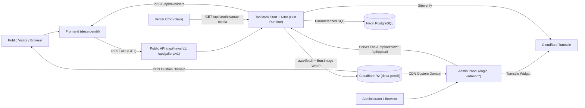

# Desa Pendil Backend

API service and administrative panel for the Desa Pendil website. Administrators manage news, articles, announcements, and photo galleries here, while the public frontend consumes them via the REST API.

Built with **TanStack Start**, **TanStack Router**, **Vite 8**, **Nitro**, **React 19**, **TypeScript**, **Tailwind CSS 4**, **shadcn/ui**, **TanStack Query 5**, **react-hook-form** with **Zod**, **Neon PostgreSQL** (`@neondatabase/serverless`), self-contained scrypt password hashing and HMAC-SHA256 session authentication, **Cloudflare Turnstile** bot defense, **Cloudflare R2** for media storage, **Biome**, and **Vitest**.

---

## Tech Stack

- **Framework**: TanStack Start 1.169 (Full-stack SSR with Nitro)
- **Routing**: TanStack Router 1.170 (100% type-safe file-based routing)
- **Bundler & Build Tool**: Vite 8.3
- **Runtime & Package Manager**: Bun 1.4+
- **Database**: Neon Serverless PostgreSQL (`@neondatabase/serverless`)
- **Styling**: Tailwind CSS 4 with `@tailwindcss/vite`
- **Component Kit**: shadcn/ui (Radix UI primitives), Lucide Icons, next-themes
- **Client State & Forms**: TanStack Query 5, react-hook-form, Zod 4
- **Bot Defense**: Cloudflare Turnstile (`@marsidev/react-turnstile`) with server-side validation
- **Auth & Security**: HMAC-SHA256 signed session cookies, scrypt password hashing, database-backed rate limiting, same-origin verification
- **Media Storage**: Cloudflare R2 (`aws4fetch` + `Bun.Image` WebP pipeline)
- **Code Hygiene**: Biome 2.6 (Linter & Formatter)
- **Testing**: Vitest 5.0 with strict boundary validation

---

## System Architecture



## Project Structure

```text
src/
├── routes/
│   ├── __root.tsx                  # Global HTML shell, providers, and theme initialization
│   ├── index.tsx                   # Root redirect to /admin dashboard
│   ├── login.tsx                   # Admin login page with Cloudflare Turnstile
│   ├── admin.tsx                   # Authenticated admin layout (AdminShell sidebar)
│   ├── admin/
│   │   ├── index.tsx               # Dashboard metrics & storage readiness alert
│   │   ├── storage.tsx             # R2 media quota monitor and asset table
│   │   ├── articles/               # News & articles CRUD pages (list, new, edit)
│   │   └── gallery/                # Gallery photos CRUD pages (list, new, edit)
│   └── api/
│       ├── news/v1/                # Public published articles API endpoints
│       ├── gallery/v1/             # Public gallery photos API endpoint
│       ├── admin/                  # Protected admin CRUD, storage & image diagnostics API
│       ├── auth/                   # Login (Turnstile + rate limit) and logout handlers
│       ├── cron/
│       │   └── cleanup-media.ts    # Daily cleanup for orphaned R2 media and rate limits
│       ├── upload.ts               # Admin multipart image upload -> R2 WebP (full + thumb)
│       └── health.ts               # Service & Neon database connectivity health check
├── features/
│   ├── articles/                   # Article UI components, services, queries, repositories
│   ├── auth/                       # Login UI, session service, schemas, server functions
│   ├── dashboard/                  # Dashboard metric aggregation service
│   ├── gallery/                    # Gallery UI components, services, queries, repositories
│   ├── health/                     # Health check service and database ping repository
│   └── uploads/                    # Bun.Image WebP pipeline, R2 quota dashboard, cleanup service
├── components/
│   ├── admin-kit/                  # Admin shell, tables, pagination, search, Turnstile field
│   ├── providers/                  # TanStack Query & next-themes providers
│   └── ui/                         # Reusable shadcn/ui primitives
├── hooks/
│   └── use-mobile.ts               # Responsive viewport hook for admin navigation
├── lib/
│   ├── api/                        # withApi() wrapper, errors, CSRF & IP rate limiter
│   ├── auth/                       # scrypt password hashing, HMAC-SHA256 session cookies
│   ├── db/                         # Neon serverless PostgreSQL client
│   ├── image/                      # Client-side image pre-shrink helper prior to upload
│   ├── query/                      # TanStack Query client factory
│   ├── schemas/                    # Shared Zod validation & pagination schemas
│   ├── storage/                    # Cloudflare R2 S3 client (aws4fetch) & media URL helpers
│   ├── env.ts                      # Validated server environment configuration
│   ├── log.ts                      # Structured JSON server logger
│   └── revalidate.ts               # Background frontend cache revalidation dispatcher
├── server/
│   └── turnstile.ts                # Server-only Cloudflare Turnstile token verification
├── types/
│   └── bun-image.d.ts              # Type definitions for Bun.Image runtime API
├── globals.css                     # Tailwind CSS 4 styling and dark mode tokens
├── router.tsx                      # Router factory and TanStack Router registration
└── routeTree.gen.ts                # Generated route tree (maintained by router plugin)
```

The codebase strictly enforces three architectural layers:

1. **Route Handlers & Server Endpoints** (`src/routes/api/**/*.ts`): Thin entry points wrapped with `withApi()`. Handlers validate input schemas, apply rate limits, enforce same-origin CSRF checks, and return standard JSON envelopes.
2. **Services** (`src/features/**/service.ts`): Core business logic, data transformation, authorization checks, and on-demand cache revalidation triggers.
3. **Repositories** (`src/features/**/repository.ts`): The only layer permitted to query Neon PostgreSQL via parameterized SQL statements.

Layer boundaries are automatically validated by `bun run check:boundaries`. Client components cannot import server modules or make untracked external fetch calls.

---

## Getting Started

### 1. Prerequisites

- [Bun](https://bun.sh) (version 1.0 or newer) or Node.js >= 22
- A Neon PostgreSQL database project ([neon.tech](https://neon.tech))
- A Cloudflare R2 bucket (`desa-pendil`) with S3 API credentials and public custom domain (required for photo uploads)
- A Cloudflare Turnstile account (free tier from [dash.cloudflare.com](https://dash.cloudflare.com))

### 2. Environment Setup

Copy `.env.example` to `.env.local`:

```bash
# Windows
copy .env.example .env.local

# macOS / Linux
cp .env.example .env.local
```

Configure `.env.local` with your credentials:

| Variable | Description | Requirement |
| :--- | :--- | :--- |
| `DATABASE_URI` | Neon PostgreSQL connection string (`postgresql://...`). Supports `DATABASE_URL` or `POSTGRES_URL` as fallbacks. | Required |
| `SESSION_SECRET` | Secret string (minimum 32 characters, recommended 64+) used to sign HMAC-SHA256 session cookies. | Required |
| `R2_ACCESS_KEY_ID` | Cloudflare R2 S3-compatible access key ID (scoped to the `desa-pendil` bucket). | Required for uploads |
| `R2_SECRET_ACCESS_KEY` | Cloudflare R2 S3-compatible secret access key. | Required for uploads |
| `R2_ENDPOINT` | Cloudflare R2 S3 API endpoint (`https://<ACCOUNT_ID>.r2.cloudflarestorage.com`). | Required for uploads |
| `R2_BUCKET_NAME` | Cloudflare R2 bucket name (`desa-pendil`). | Required for uploads |
| `R2_PUBLIC_DOMAIN` | Custom public CDN domain for R2 media (e.g. `https://media-dp.raflisahrul.my.id`). | Required for uploads |
| `R2_APP_QUOTA_MB` | Optional application media storage quota in MB for monitoring alerts (default `2560`). | Optional |
| `ALLOWED_ORIGINS` | Comma-separated list of allowed frontend origins for CORS (e.g. `http://localhost:5173,https://desapendil.id`). | Required for public API |
| `FRONTEND_URL` | Public frontend URL. The backend triggers on-demand revalidation here on content updates. | Optional |
| `REVALIDATE_SECRET` | Shared secret token for frontend cache revalidation. | Optional |
| `CRON_SECRET` | Secret token used by Vercel Cron to trigger daily orphaned media cleanup. | Optional |
| `TURNSTILE_SECRET_KEY` | Secret key from Cloudflare Turnstile for server-side siteverify (never expose to client). | Required for login |
| `VITE_TURNSTILE_SITE_KEY` | Public site key for client Turnstile widget (prefixed with `VITE_`). | Required for login |
| `TURNSTILE_ALLOWED_HOSTNAMES` | Comma-separated list of allowed hostnames (e.g. `desapendil.id,admin.desapendil.id`). | Required in production |

Generate a cryptographically secure session secret with:

```bash
bun -e "console.log(require('crypto').randomBytes(32).toString('hex'))"
```

### 3. Install Dependencies

```bash
bun install
```

### 4. Push Database Schema

Apply `scripts/schema.sql` to your Neon PostgreSQL database:

```bash
bun run db:push
```

### 5. Create Admin Account

Register your initial admin credentials in Neon PostgreSQL:

```bash
bun run create-admin -- admin@desapendil.id
```

You will be prompted to enter a password (minimum 8 characters).

### 6. Start Development Server

```bash
bun dev
```

The development server starts at `http://localhost:4000`. Access the admin panel at `http://localhost:4000/login`.

---

## Route Architecture

All routes follow TanStack Start file-based routing inside `src/routes/`:

### Admin UI Pages

| Route File | URL Path | Type | Purpose |
| :--- | :--- | :--- | :--- |
| `src/routes/__root.tsx` | Root shell | Layout | HTML document, Montserrat typography, ThemeProvider, QueryProvider, Toaster, notFoundComponent, errorComponent |
| `src/routes/index.tsx` | `/` | Redirect | Automatically redirects visitors to `/admin` via `beforeLoad` |
| `src/routes/login.tsx` | `/login` | Page | Administrator login form with Cloudflare Turnstile bot verification |
| `src/routes/admin.tsx` | `/admin` | Layout | Protected administrative layout with `AdminShell` and `beforeLoad` auth verification |
| `src/routes/admin/index.tsx` | `/admin` | Page | Dashboard with overview metrics, quick actions, and registered API directory |
| `src/routes/admin/articles/index.tsx` | `/admin/articles` | Page | Content management list with search filter (`?q=`) and pagination (`?page=`) |
| `src/routes/admin/articles/new.tsx` | `/admin/articles/new` | Page | Form to create a new article, news item, or village announcement |
| `src/routes/admin/articles/$id.edit.tsx` | `/admin/articles/$id/edit` | Page | Edit view for an existing article by identifier |
| `src/routes/admin/gallery/index.tsx` | `/admin/gallery` | Page | Photo gallery management list with pagination (`?page=`) |
| `src/routes/admin/gallery/new.tsx` | `/admin/gallery/new` | Page | Form to upload and register photos for the public gallery |
| `src/routes/admin/gallery/$id.edit.tsx` | `/admin/gallery/$id/edit` | Page | Edit view for gallery image captions and display order |

### Server API Endpoints

All API responses follow a uniform JSON envelope: `{ "success": true, "data": ... }` or `{ "success": false, "error": "..." }`. Listing endpoints return `{ "items": [...], "pagination": { "page", "limit", "total", "totalPages" } }`.

| Method | Path | Access | Cache Header | Description |
| :--- | :--- | :--- | :--- | :--- |
| GET | `/api/health` | Public | `no-store` | Database connectivity and health check |
| GET | `/api/news/v1` | Public | `s-maxage=60, SWR=300` | List published news articles (`?q=&page=&limit=`) |
| GET | `/api/news/v1/$id` | Public | `s-maxage=60, SWR=300` | Retrieve a single published news item by ID or slug |
| GET | `/api/gallery/v1` | Public | `s-maxage=60, SWR=300` | List published photo gallery items in display order |
| GET, POST | `/api/admin/articles` | Admin | `no-store` | List all articles (including drafts) or create a new article |
| GET, PATCH, DELETE | `/api/admin/articles/$id` | Admin | `no-store` | Retrieve, update, or delete an article by ID |
| GET, POST | `/api/admin/gallery` | Admin | `no-store` | List all gallery photos or register a new photo |
| GET, PATCH, DELETE | `/api/admin/gallery/$id` | Admin | `no-store` | Retrieve, update, or delete a gallery photo by ID |
| POST | `/api/auth/login` | Session | `no-store` | Admin login (protected by Cloudflare Turnstile and IP rate limiting) |
| POST | `/api/auth/logout` | Session | `no-store` | Clears admin session cookie |
| GET | `/api/cron/cleanup-media`| Public (Bearer)| `no-store` | Daily cleanup for orphaned R2 images |
| POST | `/api/upload` | Admin | `no-store` | Multipart image upload (JPG, PNG, WebP up to 4 MB) |

---

## Security Hardening

- **Cloudflare Turnstile**: Zero-friction bot defense integrated into the administrative login form. Verification occurs server-side via `src/server/turnstile.ts` with strict fail-closed handling, a 5-second network timeout, action validation (`action === 'login'`), single-use token enforcement, and hostname whitelist checks.
- **Database Access**: Uses `@neondatabase/serverless` over HTTPS with prepared SQL statements. Direct SQL concatenation is forbidden.
- **Password Protection**: Uses native Node.js `crypto.scrypt` with unique 16-byte cryptographically secure random salts.
- **Session Authentication**: HMAC-SHA256 signed session cookies (`HttpOnly`, `SameSite=Lax`, `Path=/`, valid for 7 days). Cookies use `Secure` automatically in production environments.
- **Rate Limiting**: Database-backed sliding window rate limiter keyed by client IP (e.g. 8 attempts per 10 minutes for login).
- **CSRF & Same-Origin Defense**: State-changing requests (`POST`, `PATCH`, `DELETE`) enforce strict Origin and Host header verification.
- **Media Upload Validation**: File uploads check binary magic bytes to guarantee that uploaded files match real image signatures, preventing MIME-type spoofing.

---

## Vercel Firewall & Edge Hardening

For production environments deployed on Vercel, configure the following edge rules under **Project Dashboard > Security / Firewall > Custom Rules**:

1. **Rate Limiting for Authentication (`/api/auth/login`)**:
   - Condition: `Path equals /api/auth/login` AND `Method equals POST`
   - Action: `Rate Limit` (e.g. 10 requests per 60 seconds per Client IP)
2. **Rate Limiting for Server Functions (`/_serverFn/*`)**:
   - Condition: `Path starts with /_serverFn/`
   - Action: `Rate Limit` (e.g. 60 requests per 60 seconds per Client IP)
3. **Emergency Attack Mitigation**:
   - Under DDoS or coordinated credential attacks, enable **Attack Challenge Mode** in Vercel Firewall to enforce edge-level challenges across all incoming traffic.
   - For teams with Vercel Enterprise/Pro Security add-on, enable **Vercel BotID** as an orthogonal, zero-trust edge layer preceding application-level Turnstile checks.

---

## Deployment to Vercel

The application compiles via Nitro into standalone serverless or Node.js server bundles:

1. Import the repository into your Vercel account.
2. In Project Settings > General, ensure the Framework Preset is set to `Other` (or `TanStack Start`), the build command is `bun run build`, and the output directory is `.output`.
3. In Project Settings > Environment Variables, configure the variables separately for Production, Preview, and Development:
   - **Production**: Real `DATABASE_URI`, `SESSION_SECRET`, `TURNSTILE_SECRET_KEY`, `VITE_TURNSTILE_SITE_KEY`, and `TURNSTILE_ALLOWED_HOSTNAMES`.
   - **Preview & Development**: Use Cloudflare official dummy keys (`1x0000000000000000000000000000000AA` / `1x00000000000000000000AA`) to ensure pull request previews and automated CI tests never block builds.
4. Configure Cloudflare R2 bucket (`desa-pendil`) with a custom domain and set `R2_ACCESS_KEY_ID`, `R2_SECRET_ACCESS_KEY`, `R2_ENDPOINT`, `R2_BUCKET_NAME`, and `R2_PUBLIC_DOMAIN` in Environment Variables (see `docs/r2-notes.md`).
5. Trigger a deployment and verify service status via `GET /api/health`.

---

## Available Commands

| Command | Action |
| :--- | :--- |
| `bun dev` | Starts local development server on port 4000 |
| `bun run build` | Compiles optimized client and Nitro SSR bundles |
| `bun run start` | Previews the production build locally on port 4000 |
| `bun run preview` | Alias for `bun run start` |
| `bun run typecheck` | Validates TypeScript types with `tsc --noEmit` |
| `bun run lint` | Runs Biome to check code quality and formatting (`biome check .`) |
| `bun run check` | Applies safe Biome linter and formatter autofixes (`biome check --write .`) |
| `bun run format` | Formats all files with Biome (`biome format --write .`) |
| `bun run format:check` | Validates code formatting with Biome |
| `bun run test` | Runs Vitest unit and integration test suite |
| `bun run check:boundaries`| Verifies clean architecture layer boundaries |
| `bun run db:push` | Applies database schema to Neon PostgreSQL |
| `bun run create-admin` | Registers or updates an admin user in Neon PostgreSQL |
